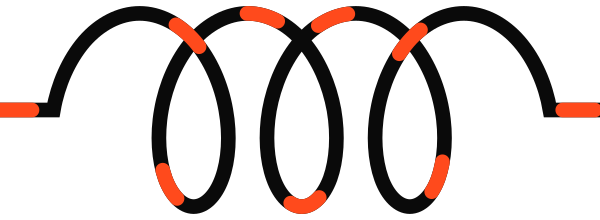
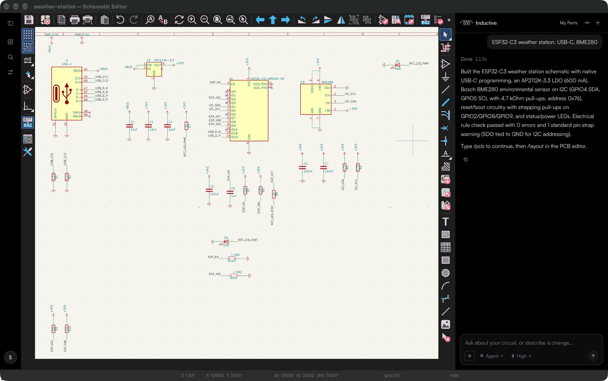
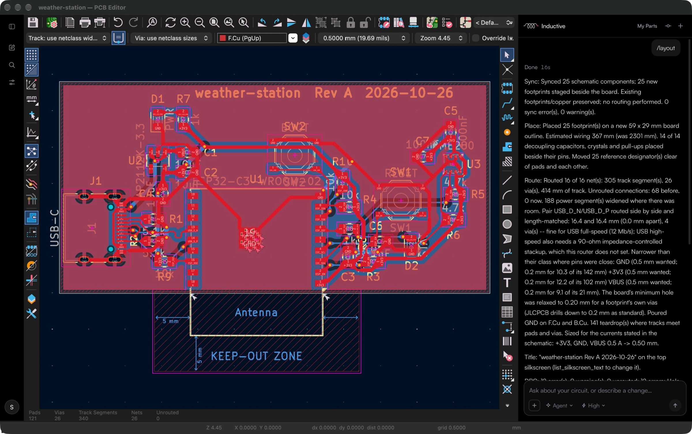
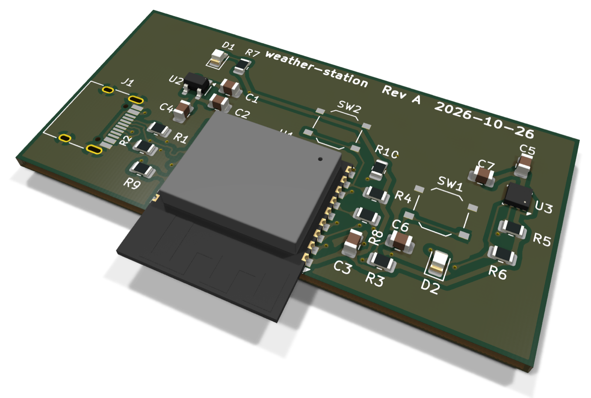
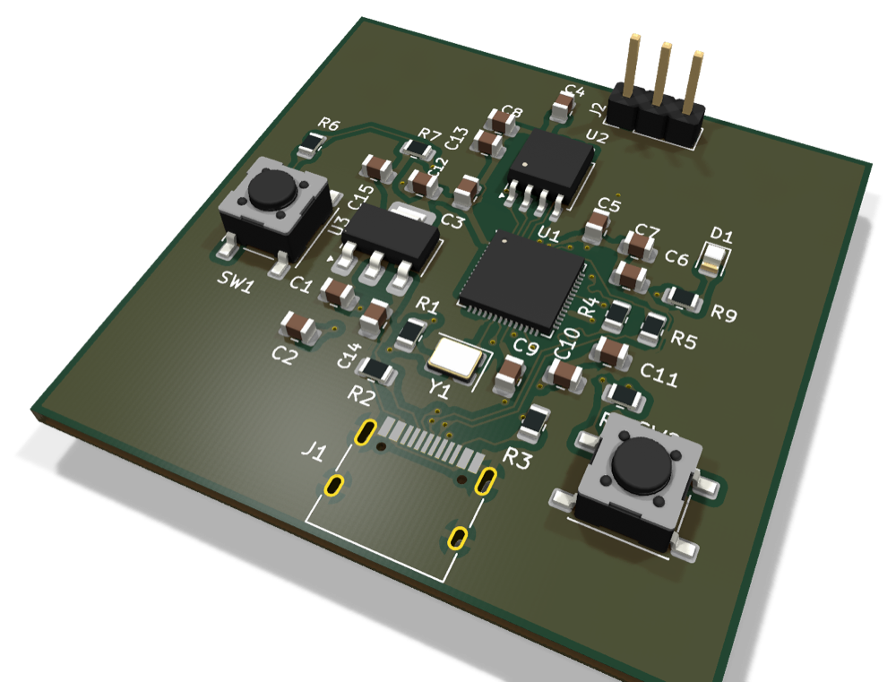
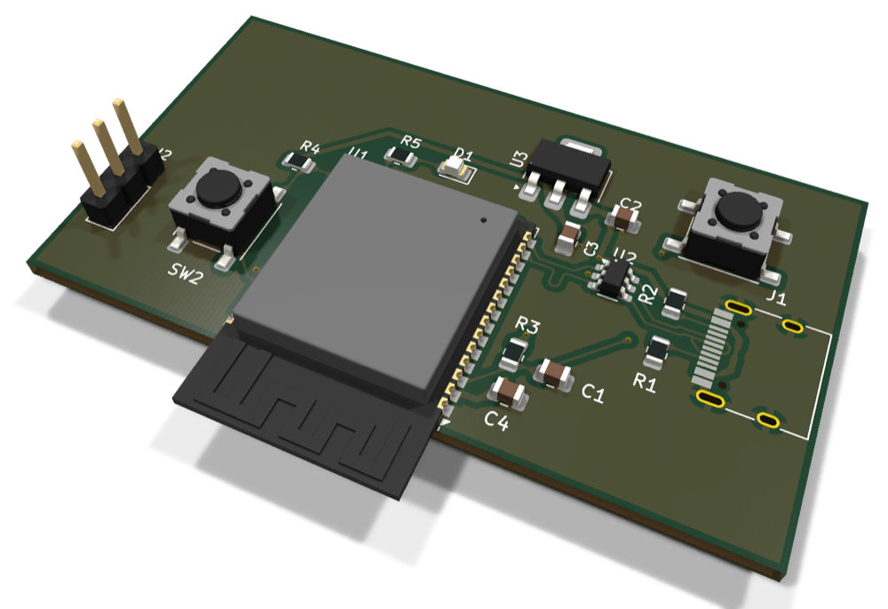
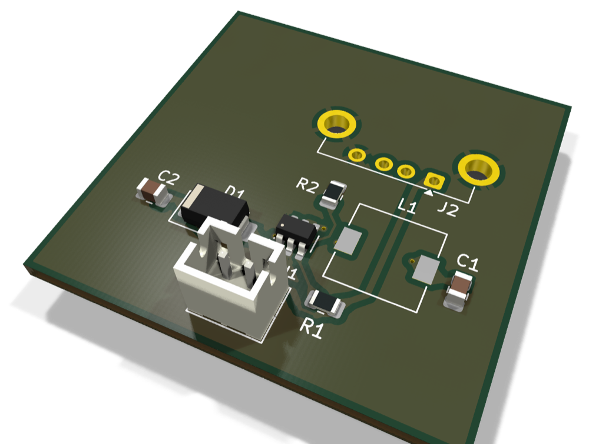
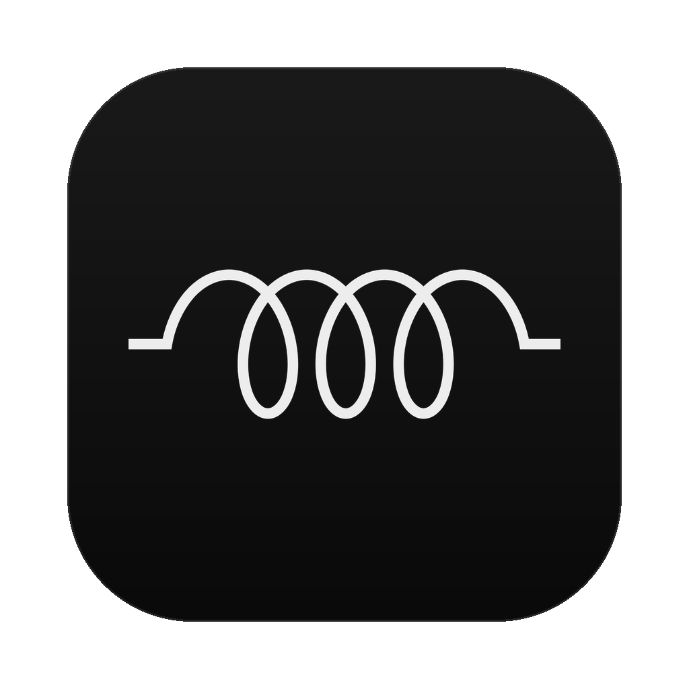

<picture>
  <source media="(prefers-color-scheme: dark)" srcset="brand/logo-dark.svg">
  
</picture>

# Inductive

**Describe a circuit. Get a board you can order.**

Inductive is a PCB design app built on [KiCad](https://www.kicad.org) 10, with a design
partner in the sidebar of the schematic and board editors. Ask for a circuit and it draws
the schematic with real parts. Type `/layout` and it places, routes and checks the board.
Then export the files your fab needs.

 

One prompt, about two minutes: an ESP32-C3 board with USB-C, a 3.3 V regulator, a BME280 sensor on I²C,
reset and boot buttons and status LEDs, checked by ERC.

 

## From a sentence to a board

<table>
  <tr>
    <td width="50%" valign="top">
      <h3>✏️ Schematics from a sentence</h3>
      Say what you're building. Inductive picks real parts, draws a readable schematic,
      wires every net and checks it with KiCad's electrical rules check.
    </td>
    <td width="50%" valign="top">
      <h3>💬 Edit by asking</h3>
      "Change R1 to 2.2k." "Add a reverse-polarity diode." Changes land as ordinary KiCad
      edits you can undo, with a change history to go back to any earlier point.
    </td>
  </tr>
  <tr>
    <td width="50%" valign="top">
      <h3>⚡ One-command layout</h3>
      <code>/layout</code> brings the schematic onto the board, places the parts, routes every
      net, pours ground, adds teardrops and runs DRC. Two layers by default; ask for four or
      six and it adds the inner planes.
    </td>
    <td width="50%" valign="top">
      <h3>🔩 Parts you can actually buy</h3>
      Inductive sources parts with LCSC numbers so JLCPCB can assemble them. Keep the ones you trust in
      <b>My Parts</b> and reuse them across designs.
    </td>
  </tr>
  <tr>
    <td width="50%" valign="top">
      <h3>📦 Ready for the fab</h3>
      Gerbers, drill files, BOM and pick-and-place files for JLCPCB, with a check that stops a
      board with DRC errors or unrouted nets from going out.
    </td>
    <td width="50%" valign="top">
      <h3>🧰 Still KiCad underneath</h3>
      Every KiCad editor, library and file format is here. Import your existing KiCad projects
      and keep working; the sidebar is there when you want it.
    </td>
  </tr>
</table>

## How it works

| Where | Command | What it does |
|---|---|---|
| Schematic | *any request* | Draws or edits the schematic, then runs ERC |
| Schematic | `/pcb` | Opens the board with the schematic ready to bring over |
| PCB | `/layout` | Sync, place, route and check the board in one step |
| PCB | `/sync` · `/place` · `/route` · `/drc` | The same steps, one at a time |

## Screenshots

The same design after <code>/layout</code>: 25 parts placed, 16 of 16 nets routed, USB pair
length-matched, ground poured on both sides and an antenna keep-out under the module.

  

### Boards laid out by Inductive

<table>
  <tr>
    <td align="center" width="33%"> <b>RP2040</b> minimal board</td>
    <td align="center" width="33%"> <b>ESP32</b> with USB</td>
    <td align="center" width="33%"> <b>MT3608</b> boost converter</td>
  </tr>
</table>

Rendered with KiCad's raytracer from boards placed and routed by Inductive's layout engine.

## Download

<a href="https://storage.googleapis.com/inductive-dev-releases-5106138e/Inductive.dmg"><b>Download Inductive for macOS</b></a>,
open the disk image and drag Inductive into Applications.

- **macOS 14 Sonoma or later** on an **Apple Silicon** Mac (M1 or newer)
- Signed and notarized by Apple, so it opens without warnings
- Updates itself: a new version installs the next time you open the app
- Sign in with an Inductive account to use the sidebar; a free plan is included

A Windows version is in the works; its build scripts are already in this repository.

## Building from source

This repository is the source of the desktop app: the changes it makes to KiCad and the
editor-side code compiled into it.

<b>macOS</b>

1. Get KiCad 10.0.7: `git clone --branch 10.0.7 https://gitlab.com/kicad/code/kicad.git`
2. Apply the patches, in order: `for p in patches/*.patch; do git -C kicad apply "$p"; done`
3. Link this repository into it: `tools/install-into-kicad.sh /path/to/kicad`
4. Build KiCad as its documentation describes (on macOS with
   [kicad-mac-builder](https://gitlab.com/kicad/packaging/kicad-mac-builder)), then
   install the app with `tools/install-app.sh`.

Or let one script do all of it, the way the [macOS build workflow](.github/workflows/macos.yml)
does on a macOS 14 machine: `tools/build-macos.sh WORKDIR 14.0`. Homebrew's libraries match the
macOS they're installed on, so the oldest macOS the app runs on is the one it was built on.

The app reads its server settings from `~/.config/inductive/env`
(`INDUCTIVE_API_BASE`, `INDUCTIVE_GCP_PROJECT_ID`, `INDUCTIVE_FIREBASE_API_KEY`,
`INDUCTIVE_FIREBASE_AUTH_DOMAIN`). The UI uses the Satoshi typeface from
[Fontshare](https://www.fontshare.com/fonts/satoshi), which is not included: put
`Satoshi-Regular.woff2`, `Satoshi-Medium.woff2` and `Satoshi-Bold.woff2` in `web/fonts/`,
or the pages fall back to the system font.

<b>Windows</b>

The Windows build uses KiCad's own Windows builder,
[kicad-win-builder](https://gitlab.com/kicad/packaging/kicad-win-builder), with Visual
Studio 2022 Build Tools (the C++ workload) and Git for Windows.

1. Clone kicad-win-builder (made against commit 1b7a908) to e.g. `C:\b\kicad-win-builder`.
2. Prepare KiCad 10.0.7 with this repository's patches and sources in its
   `.build\kicad` folder: run `tools/install-into-kicad.sh` on a KiCad 10.0.7 checkout
   (on any machine with a POSIX shell), then copy the tree with the links replaced by the
   files they point to.
3. Clone `kicad-symbols`, `kicad-footprints` and `kicad-templates` at tag 10.0.7 into
   `.build\`, and make an empty `.build\kicad-packages3D` folder.
4. Put the server settings in `cloud.env` (the four keys above, plus
   `INDUCTIVE_UPDATE_CHANNEL` for a build that updates itself).
5. Run `packaging\windows\build-windows.ps1 -Steps init,vcpkg,build,prepare,package`.
   The first build compiles KiCad's dependencies with vcpkg and takes hours.

The installer, `Inductive-<version>-windows-x86_64-setup.exe`, lands in the builder's
`.out` folder. It installs for the current user by default; the programs are
`inductive.exe`, `inductive-pcb.exe` and `inductive-schematic.exe`.

### What's in this repository

| Path | What it is |
|---|---|
| `patches/` | The changes to KiCad 10.0.7, applied in order |
| `src/` | The sidebar, Home, sign-in, updates and the editor tools, compiled into KiCad |
| `web/` | The sidebar and Home pages |
| `examples/circuits/` | The reference circuits the app ships |
| `tools/` | Build, install, signing and packaging scripts (macOS) |
| `packaging/` | Signing settings and the install window (macOS), installer and build scripts (Windows) |
| `.github/workflows/` | The macOS 14 build |
| `brand/` | The logo and app icon (see [NOTICE](NOTICE): the name and logo are trademarks) |
| `docs/` | The pictures in this README |

### What runs on Inductive's servers

The design assistant, board layout (placement, routing, pours and board setup) and parts
sourcing run on Inductive's servers and need an Inductive account. They are separate
programs, not part of this app, and are not in this repository. The app talks to them over
HTTPS.

## License

Inductive's desktop app is free software under the **GNU General Public License, version 3
or any later version**; see [LICENSE](LICENSE) and [NOTICE](NOTICE). KiCad's own licensing is
described in its [LICENSE.README](https://gitlab.com/kicad/code/kicad/-/blob/10.0.7/LICENSE.README).

The name "Inductive" and the Inductive logo and icon are trademarks and are not licensed
under the GPL. Inductive is built on KiCad and is not affiliated with or endorsed by the
KiCad project.

 

 
Made for people who would rather be building the thing than drawing it.

